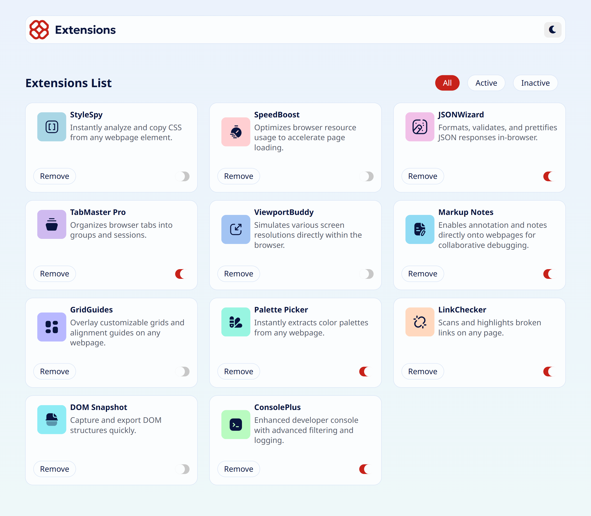
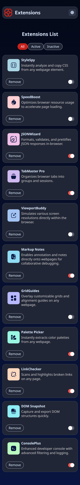

# Browser Extensions Manager UI – React

A responsive Browser Extensions Manager built with React.

This project is a React-based recreation of my original Browser Extensions Manager UI project, originally developed using HTML, CSS, and Vanilla JavaScript.

The goal of this project was to rebuild the same interface using React and practice component-based development, state management, and working with browser storage.

## 📑 Table of Contents

- [Live Demo](#-live-demo)
- [Original Project](#-original-project)
- [Features](#-features)
- [Built With](#built-with)
- [What I Learned](#-what-i-learned)
- [Run Locally](#-run-locally)
- [Preview](#-preview)
- [Author](#author)
- [Contact](#-contact)

## 🚀 Live Demo

[View Live Demo](https://kazemhazara.github.io/browser-extensions-manager-react/)

## 🔗 Original Project

This React version is based on my original project built with HTML, CSS, and Vanilla JavaScript.

[View Original Vanilla JavaScript Project](https://github.com/kazemhazara/browser-extensions-manager)

## ✨ Features

- Display a list of browser extensions.
- Filter extensions by All, Active, and Inactive.
- Toggle extensions between active and inactive states.
- Remove extensions from the list.
- Switch between Light and Dark themes.
- Save extensions' states using Local Storage.
- Remember the selected theme after refreshing the page.
- Responsive design for different screen sizes.

## Built With

- React
- JavaScript (ES6+)
- HTML5
- CSS3
- Vite
- Local Storage

## 📚 What I Learned

While building this project, I practiced:

- Creating and organizing reusable React components.
- Passing data and functions between components using props.
- Managing application state with `useState`.
- Using event handlers to update application state.
- Rendering lists dynamically with `map()`.
- Filtering and removing items using JavaScript array methods.
- Updating state immutably.
- Using Lazy Initialization with `useState`.
- Persisting application data using Local Storage.
- Implementing Light and Dark themes in React.

## 💻 Run Locally

1. Clone the repository:

   ```bash
   git clone https://kazemhazara.github.io/browser-extensions-manager-react/
   ```

2. Navigate to the project directory:

   ```bash
   cd browser-Extensions-Manager-React
   ```

3. Install dependencies:

   ```bash
   npm install
   ```

4. Start the development server:

   ```bash
   npm run dev
   ```

5. Open the local URL provided by Vite in your browser.

## 📸 Preview

### Desktop View



### Mobile View




## Author
<a href="https://github.com/kazemhazara">
  
</a>

Built as part of my journey to improve my frontend development skills and learn React.

## 📬 Contact

Feel free to connect with me through the following platforms:
<p align ="left">
  <a href="mailto:kaz.hazara@gmail.com">
    
  </a>
  <a href="https://wa.me/kazemhazara">
    
  </a>
  <a href="https://www.linkedin.com/in/kazemhazara">
    
  </a>
</p>


